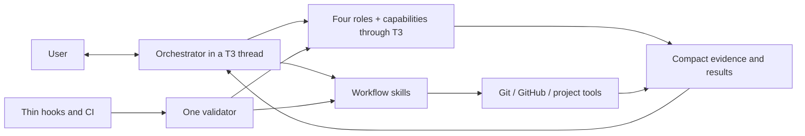

# Orchestra Architecture

## Architectural objective

Build an orchestration product for T3 Code whose complexity is dominated by
software delivery work, not by its own control plane. T3 Code is the one
execution host and the providers it runs are executors; shared skills, helpers,
and Git remain one copy.



## Target repository shape

```text
Orchestra/
├── README.md
├── VISION.md
├── AGENTS.md
├── orchestra.toml
├── .agent/
│   └── backend-testing.md
├── docs/
│   ├── WORKFLOW.md
│   ├── ARCHITECTURE.md
│   └── ROADMAP.md              # non-canonical sequencing
├── packaging/                # plugin metadata, Claude Code read hook and usage
├── .githooks/                 # versioned thin wrappers only
└── codex/
    ├── config/flow.toml       # default flow assignment
    ├── skills/                # public lanes and internal playbook references
    ├── scripts/               # deterministic mechanical helpers
    └── tests/
```

## Component responsibilities

### Orchestrator

Owns user dialogue, product clarification, capability routing,
synthesis, the local task plan, in-scope decisions, blocker resolution, phase
commits, PR synthesis and observation, delivery choice, and final judgment. It
holds compact authority and decision context and delegates repository-wide
reading. Current source and Git remain authoritative; task-private evidence
artifacts let downstream agents navigate prior analysis without requiring the
root to rewrite it.

The root preserves the approved objective, constraints, acceptance, and
authority while treating any proposed mechanism or causal explanation as a
hypothesis to test against current evidence. It owns user-facing explanation
and distinguishes verified facts, supported inference, and uncertainty. It may
use an available visualization capability when a complex sequence, hierarchy,
comparison, or mapping becomes materially clearer. Simple prose is the default,
missing visualization support is non-blocking, and delegated agents never own
user-facing visualization.

Initiative task roots use this same workflow. An investigation-only child may
gather bounded evidence before implementation approval, then
continue through the existing approval path. WORKFLOW "Initiative coordination"
owns that authority and recovery contract; task size does not select a second
worker workflow.

After obtaining a bounded minimum brief and resolving the flow assignment, the
orchestrator performs a short read-only Git and execution-readiness
preflight, grounds the specification dialogue in focused repository context
(gathered directly or by a dispatched analyst), and confirms the complete
specification. Immediately after that confirmation the root uses Git directly
to create a collision-free task branch in either a managed Orchestra-root
worktree or the current clean hybrid checkout, keeps that task-checkout
identity in transient context before plan approval, passes the exact checkout to every
capability.

For each implementation phase, the root also keeps transient handles for the
implementation owner, reviewer, only verifiers required by the independent
gate, and only explicitly retained non-browser temporary processes created for
that phase. Agents close their owned resources before each handoff by default;
fixes, reruns and delta reviews are fresh sessions. Before commit,
the root follows up only on authorized retention or incomplete cleanup. Agent
and resource handles remain in memory.
At any earlier handoff, blocked cleanup prevents downstream dispatch and
receives one cleanup-only return to the same owner; failure to clear it blocks
the phase. A source-read-only task tab or window may remain partial until phase
teardown.

The active implementation owner defines a stable observation boundary. Until
that owner returns an outcome or blocker, the root coordinates without reading
the evolving implementation diff, exercising it with speculative canaries, or
sending design corrections. At each handoff the root may perform one bounded
Git identity, status, allowed-scope, `diff --check`, and evidence-inventory
check. A required user preview starts only at that handoff and keeps only the
resources needed to show the approved result. The same logical owner absorbs
any in-scope user delta after resume unless it is confirmed unavailable. The
frozen revision is that post-absorption revision with green handoff checks.
WORKFLOW "User preview" owns preview process retention and cleanup.
A root-originated correctness investigation completes against the
current source and diff before it produces one consolidated finding packet with
evidence, impact, and acceptance.

At that stable boundary, the root also owns disposition of material context
discoveries returned from any role; discoveries never expand their producer's
authority or create a context store. Approved plans expose context without a
registry: the overview carries a provenance-preserving `Review context` index
and each phase names its exact evidence dependencies plus exact non-glob
`Context maintenance paths` or `none`. Repository conventions, including
normative code conventions, live in the consumer's tracked `.agent/` files and
reach workers as exact cited paths; applicable repository instructions retain
their own authority. Operational recipes follow the separate maintenance
lifecycle in WORKFLOW "Project verification". Disposition and persistence mechanics
live in `docs/WORKFLOW.md` ("Material context discovery").

### Roles and capabilities

Orchestra has exactly four roles, each a self-contained role skill:

- The analyst (`orchestra-role-analyst`) gathers bounded evidence, researches, plans, analyzes architecture,
  or diagnoses difficult failures. It does not edit implementation files,
  commit, route agents, or claim product authority.
- The implementer (`orchestra-role-implementer`) owns scoped code and test changes for an approved
  packet and acts as the first deterministic quality gate. It runs and
  autocorrects required local deterministic checks. It may implement general or
  frontend work, but does not independently review itself, commit, or manage
  delivery.
- The reviewer (`orchestra-role-reviewer`) independently examines plans, architecture, code, meaningful
  deltas, tests, and verification evidence. It does not routinely repeat gates,
  reports evidence-backed findings, and never silently implements them.
- The verifier (`orchestra-role-verifier`) supplies dedicated independent runtime or browser evidence
  only when phase risk or policy requires it. It does not edit source code or
  reinterpret a failing result as success.

Each dispatch sends one role skill with one explicit named capability selected
by the root. `general_implementation` and `independent_review` are assignment
keys whose behavior stays in the implementer and reviewer role skills; they
have no internal playbooks. Internal playbooks exist only for
`repository_context`, `web_research`, `technical_planning`,
`difficult_debugging`, `frontend_implementation`, `browser_acceptance`, and
`runtime_verification`. The existing `architecture_guidance.md` is the shared
architecture and engineering reference consumed by the relevant roles and
playbooks, including standalone use; operational routing and evidence placement
live in WORKFLOW "Engineering guidance and evidence". The
`architecture_analysis` assignment has no separate playbook. Playbooks are
internal references, not public skills or additional personas. Public skill
identifiers include the reusable engineering and project-verification entries,
explicit initiative coordination, greenfield project-start,
and explicit `orchestra-repo-readiness`. Readiness
reuses the four roles and existing execution routes; WORKFLOW "Repository
readiness" owns its authority and lifecycle. Shared engineering guidance owns
the comment policy and prevention criteria; writing entries link them directly.

Frontend implementation and browser acceptance are independent capabilities on
different roles. Root-owned plan authority, commits, PR observation,
routing, and final judgment add no role or capability key; a
dispatched technical planner may author the exact candidate documents that the
root approves or rejects.

The implementation owner, reviewer, and each required capability verifier form
a bounded phase cohort. Ordinary deterministic phases have no verifier.
A required user preview keeps the same logical owner through absorption under
WORKFLOW "User preview" and "Phase execution". One-shot analysts close after
their result is consumed. The cohort
closes only after final phase evidence is consumed, preserving relevant context
without carrying implementation state across phases. Analysis agents are
one-shot except that a technical planner remains open through a dispatched
plan-review correction loop and closes before implementation.

Roles share only minimal conventions: explicit capability and authority,
worktree, exact target artifact identifiers and roles, revision identity,
accepted finding identifiers, new context delta, stop conditions, and
outcome-first output status. Reusable results are complete
revision-identified task-private Markdown artifacts; returns carry produced
identifiers, blockers, risks, and requested decisions instead of replaying
content. Objective, scope, acceptance, verification, plan details, and prior
findings are read from named documents. Publication failure falls back to the
complete inline result or an exact private path already recorded in the
approved manifest.
Revision identity still distinguishes a committed revision from a dirty
worktree or diff state and names affected paths.

The implementation-review packet additionally carries the exact
`repository-context` and `context-delta` evidence required by the approved
overview and phase, or complete labeled inline fallbacks. This is routed
evidence, not a role, capability, persisted packet, or new artifact kind.
Retaining an inline producer result adds no artifact kind; WORKFLOW
"Task-private artifacts" owns that transfer and lifecycle.

Every role applies the same owner-cleanup contract. It tracks task-owned
servers, managed or detached processes, terminal sessions, and browser tabs in
live context; closes them before a final,
failed, or blocked handoff; and preserves unrelated user state. Analysts and
reviewers never retain resources across a handoff. Implementers and verifiers
may retain only an explicitly authorized non-browser resource category and
report its exact handle. Browser tabs are always fresh per run and never
retained across a handoff. Each handoff declares cleanup as `pass`, `partial`,
or `blocked` plus any authorized retained resources. This is an agent
instruction and transient return contract, not semantic artifact content, a
registry, or a mechanical guarantee.

When a role discovers new material context outside the immediate report
purpose, it records a conditional evidence-backed entry with a report-local
stable identifier and returns the composite artifact-and-entry identifier when
publication succeeds. On inline fallback it returns the local identifier beside
the complete report, which downstream packets keep together. The entry remains
part of the existing report kind. It is not an authority grant, canonical
documentation, or a separate artifact, and no empty section is emitted when
nothing new was found.

Every role preserves the approved objective, constraints, acceptance, and
authority under shared "Decision evidence" and WORKFLOW "Autonomy within an
approved objective", reporting a conflict instead of silently broadening or
replacing the approved result.

For approved implementation, focused read-only inspection of the affected flow
and relevant callers does not expand edit authority. The worker chooses existing
repository, standard-library, native-platform, or installed primitives by actual
constraints, corrects the supported root cause at the causal boundary that
explains the affected behavior within scope, rejects symptom-only patches, and
records a limitation only with evidence and a concrete revisit trigger. Review
treats complexity as material only when an unsupported consumer, requirement,
or reproducible risk makes it defect-prone; size or novelty metrics alone do
not establish a finding.

### Workflow skills

Skills describe the behavioral route and call deterministic helpers. Expected
public lanes are:

- modular engineering and project verification;
- explicit initiative coordination across independent task roots;
- implicit greenfield project start;
- explicit repository readiness, including `.agent/` conventions;
- explicit orchestration and discovery;
- planned delivery;
- phase commit;
- PR open;
- PR review;
- PR merge;
- local integration;
- repository delivery policy.

They should remain readable and route to deeper references only when needed.

### Mechanical helpers

Scripts perform operations that demonstrably benefit from deterministic
behavior: bounded Git inspection, initializing and safely cleaning the one
reserved worktree-local task-state directory, loading delivery policy, running
configured argv checks, opening or observing a PR through direct `gh`, merging
an authorized clean PR with guarded task-resource cleanup, integrating a local
fast-forward, packaging the plugin, and validating the suite.

Helpers return compact structured results. They do not make product decisions,
spawn agents, or own parallel approval systems. A helper must reduce the total
agent, tool, time, and repair cost of its operation; deterministic behavior is
not a reason to duplicate Git or the root's judgment. The root commits with
direct Git by default, may use the narrow exact-path helper, and invokes the PR
helper directly to observe GitHub state.

## Minimal contracts

Orchestra may persist only contracts with direct consumers:

- repository delivery policy;
- revision-identified Markdown artifacts in each task worktree's ignored
  `.orchestra/artifacts` directory;
- one root-owned approved task plan per confirmed checkout at
  `.orchestra/plan.md`;
- concise commit intent and validation in Git history;
- compact optional-helper result (`committed` with `sha`,
  `nothing_to_commit`, or `blocked` with the observed reason);
- one PR-CONTEXT capsule in the GitHub PR body;
- the shipped flow assignment and the user's override file, read by the root
  before dispatch.

The provisional specification remains in conversation. An unapproved formal
candidate is one `plan-overview`, one `plan-phase` per phase, and optional
`plan-review` artifacts. Its current membership is an explicit bundle of IDs,
never whichever artifacts are newest. Only after approval does the root write
`plan.md` as `active`: task/Git identity, the resolved flow assignment and
decisions, approved overview
verbatim, and an exact phase manifest with IDs, private paths, artifact
revisions, progress, commits, blocker, and next action. Phase details are not
duplicated. Git remains authoritative for branch, HEAD, commits, and worktree
state; the plan carries approved intent, exact bundle selection, and progress.

Every overview includes the semantic `Review context` section, and every phase
includes semantic context dependencies plus `Context maintenance paths` set to
exact versioned human-readable documentation paths or `none`, and
`User preview: required | none`. These sections
add no `plan.md` manifest field, coordination column, or workflow state.

Branches and worktrees are Git resources, not a new Orchestra state store.
Every new formal task uses an Orchestra-owned collision-free branch. Managed
mode owns its portable worktree; hybrid mode preserves the user/host-owned
checkout and owns only the task branch and reserved worktree-local private
state. The same live preapproval task may
continue in memory; later reuse requires the approved plan's checkout path,
branch, base, and HEAD to agree with Git. Rejected planning and completed
delivery clean only resources that exact Git evidence proves safe.

GitHub owns PR, check, and review-thread state; Orchestra creates no local PR
state file.

Artifacts are plain files in the task-private `.orchestra/artifacts` directory.
The filesystem is their only locator. The self-ignored ownership marker keeps
Git status clean; unsafe collisions block before dispatch. Legacy private paths
remain supported by local state cleanup. Artifact publication failure returns
complete evidence inline.

Artifact `kind` is a file-naming convention:
`repository-context`, `context-delta`, `plan-overview`, `plan-phase`,
`plan-review`, `implementation-report`, `verification-report`,
`implementation-review`, `debugging-report`, and `pr-review` only when PR
analysis has a downstream semantic consumer. Corrected overview and phase
documents are immutable complete replacements. Mechanical start, completion,
commit, push, check, and merge facts remain activity, Git, or GitHub state.

Material context discoveries remain sections of those existing reports and
share their task-private lifecycle. They become cross-task knowledge only when
an authorized implementation changes the repository's canonical versioned
documentation (or the applicable existing Orchestra guidance); task cleanup
does not promote them automatically. `repository_context` alone may validate a
reported candidate into a targeted `context-delta`. No discovery registry,
global context file, coordination column, or additional artifact kind exists.
The durable knowledge checkpoint before completion is one root judgment with
the existing canonical repository knowledge path as its destination; it adds no store, helper, or agent
(`docs/WORKFLOW.md`, "Durable knowledge checkpoint").

Each discovery classifies its claim as `descriptive` current-state
information, `normative` intended behavior or constraint, or `uncertain`.
Only a confirmed descriptive claim at an exact phase-authorized documentation
path may receive `persist`; executable configuration and operational data
remain normal implementation scope. The same owner makes the change and a
fresh reviewer evaluates the meaningful delta before commit.

The root keeps a compact manifest of current IDs, revision, accepted findings,
risks, and decisions. It opens complete documents for specification and
approval, authority or risk judgment, and failed convergence. The root
skill's planning stage and finding triage references own finding disposition
and convergence. No review counter or limit persists.

Do not introduce a global workflow event ledger, authority-bundle chain, duplicate Git
index, commit recovery journal, event-sourced board, benchmark control plane, or
general-purpose workflow state engine unless real usage demonstrates a
requirement Git and the local plan cannot meet. The root uses the one-shot
`adopt_worktree.py` helper only because Git does not carry selected dirty paths
into an Orchestra task worktree; that helper keeps no state.

## Modular composition

`orchestra-engineering` routes ordinary technical work to the shared guidance
without forcing it through standalone leaf roles or the full planned route.
`orchestra-project-verification` owns the consumer-facing entry for preparing,
executing and maintaining repository feature maps and recipes. These entries
reuse the existing four roles and seven playbooks; no additional persona or
assignment table is introduced. Operational authority and lifecycle live in
WORKFLOW "Modular engineering", "Project verification" and "Repository conventions".

`orchestrator` owns an explicitly selected parent responsibility across
independent task roots. Its task roots are T3 threads that retain child
context; a `delegate_task` role remains deliberately narrower.
One persistent Markdown project register links handles, plans, accepted revisions
and joint evidence for the parent/resume consumer, including concurrent tasks in
one repository. Optional stable context is separate from progress. This replaces
the old private index, does not mirror child phase state and is not an authoritative
board or scheduler. T3-created checkouts are adopted once and retained for
T3-owned cleanup; task-root resources remain separate from the flow's role
rows. WORKFLOW "Initiative coordination" owns the contract, and the
coordinator's host-transports reference maps it onto T3. A Hermes thread may
act as the parent without implementing.

## T3 Code host

Shared product, skills, packets, artifacts, Git and the four role skills are
provider-neutral. T3 Code supplies threads, worktrees (`t3_worktree_handoff`),
role transport (`delegate_task` with an explicit provider, model and effort),
completion notifications, the collaborative browser and pull request watching,
as WORKFLOW "T3 Code host" and the T3 Code reference specify. Each provider T3
runs (Claude Code, Codex, Cursor, Grok and later ones) is an executor:
supporting one is a flow row plus a role check against the live catalog, never
a host adapter. Outside T3 the role, engineering and verification skills remain
usable directly; the full workflow does not.

Role skills have one behavior contract with two contexts: a direct assignment
returns inline evidence; an approved phase supplies the workflow's artifacts
and gates. WORKFLOW "Standalone tools" owns that boundary. No alias skill or
parallel implementation of a role is needed.

## Flow assignment

`codex/config/flow.toml` is the only shipped assignment: a provider instance,
a model and an optional effort per capability, the second reviewer of the
review pair, and the later recovery attempts. The user's
`${ORCHESTRA_HOME:-$HOME/.orchestra}/flow.toml` replaces whole entries without
editing the package. The root reads both directly; there is no resolver
helper, tier, preset or per-provider matrix. Role skills stay model-free and
capability playbooks stay independent of providers; the validator keeps the
file complete and model ids out of skills. WORKFLOW "Flow assignment" owns
resolution, availability, substitution and recovery.

Model-provider bridges are separate products. CodexBridge keeps the historical
external-model reference in its own repository; nothing in Orchestra consumes
it.

## Verification environment and browser routing

Permission and browser-routing behavior is specified once in
`docs/WORKFLOW.md` ("Test permissions and browser routing"). Architecturally,
T3's runtime mode and each provider's permission choice are observed and never
written, and `browser_route` is a transient packet value: T3's collaborative
browser first, then Claude in Chrome for a Claude child started with
`--chrome`, or `codex-cu`. Browser evidence is PNG screenshot files cited from
the existing report kinds, not a new artifact kind.

## Phase resource lifecycle

Resource hygiene is owner-first and transient: agents clean exact owned
resources before each handoff, retention requires explicit packet
authorization, handles live only in root memory, and no helper discovers or
kills processes globally. Waiting uses T3's completion notifications without
busy-polling. The complete rules — cleanup statuses, teardown, verification
ordering, and the observation boundary — live in `docs/WORKFLOW.md` ("Phase
execution", "Phase teardown", and "Agent waiting"). Commit execution remains a
separate direct Git operation.

## Lightweight conformance and hooks

The workflow needs drift protection, but enforcement must remain thin.

### Canonical validator

`codex/scripts/validate_suite.py` is the only suite conformance engine. Its
checks should stay deterministic and fast enough for local use. It validates:

- required canonical files and packaging boundaries;
- skill links, role skill structure and runtime references;
- flow assignment completeness and model-free skills;
- plugin packaging boundaries and historical product narrative;
- representative workflow contract tests.

It does not validate live approvals, replay agent history, or inspect unrelated
consumer repositories.

### Hooks

The Orchestra source repository should install one versioned pre-commit wrapper
that invokes the validator's quick mode. Consumer repositories do not receive
that Orchestra validator hook, and no separate pre-push workflow is required.

Orchestra validator hooks must:

- contain no independent workflow policy;
- avoid network calls and agent launches;
- never mutate files, stage changes, or commit;
- finish quickly and print one actionable failure;
- be installable and removable explicitly.

CI may call the full validator later. Hook, CI, and manual validation must not
implement three competing rule sets.

### Behavioral tests

Tests pin structural invariants, never prose wording: explicit activation
routing, the closed four-role and seven-playbook inventory, flow assignment
completeness, and helper behavior (checkout, commit, delivery, packaging,
local task state). Behavioral
policy lives only in `docs/WORKFLOW.md` and is enforced by review, not by
sentence-freezing assertions.

## Complexity safeguards

Before accepting a persistent artifact, schema, lock, transaction layer,
helper, role, or capability playbook, document:

- its named consumer;
- a demonstrated failure, explicit requirement, or reproducible risk;
- why an existing Git, GitHub, host, or project-test primitive is insufficient;
- lifecycle, ownership, and cleanup;
- why its cost is proportional;
- why a smaller direct implementation does not suffice.

Review only the delta after a finding. If a mechanism fails this gate, stop and
simplify it. Count root and delegated-agent context, tool calls, wall time, and
failure-repair loops in that cost. Do not harden against speculative
concurrency, crashes, adversarial inputs, or exotic filesystems without a
consumer requirement or reproducible risk.

The design explicitly rejects an authoritative workflow event ledger,
authority-bundle chain, duplicate Git index, commit recovery journal, Kanban
board, general-purpose workflow state engine, and repeated validation of
unchanged authority unless later evidence passes the same gate.

Delivery uses exactly three focused helpers: `policy.py`, `pr.py`, and
`integrate_local.py`. The root invokes `pr.py` directly for open, observe, and
authorized merge and guarded post-merge cleanup; `pr.py` calls `gh` and direct
Git primitives and is not a generalized GitHub abstraction. Review-thread
observation uses one bounded GraphQL query because REST check and comment data
cannot establish thread resolution. Incomplete pagination remains `partial`,
never clean. Managed task checkouts come from T3 (`t3_worktree_handoff`) at the
configured path and exact fetched upstream commit for a remotely tracked
canonical base. Hybrid task setup first
resolves and fetches that upstream, uses `git merge --ff-only <upstream>` only
when the clean local base is strictly behind, and then uses direct
`git switch -c` against its captured HEAD. Ahead or diverged bases block instead
of being rewritten. The root proves write access with a temporary canary before
the first dispatch; active worktrees in older locations are never migrated
implicitly. Scoped dirty adoption uses `adopt_worktree.py` as a one-shot selected-path
import into the task worktree.
Phase commits use direct Git by default or the existing narrow exact-path helper
when useful, never an agent. The scoped helper refuses active Git operations
before staging through per-worktree metadata; the separately reviewed merge path
in WORKFLOW "Base refresh before delivery" uses direct Git and existing artifacts.
No merge-state helper or second transaction protocol is introduced.

The approved plan remains the source of the terminal phase commit. PR open, PR
merge, and local integration receive that exact full SHA as an explicit helper
argument and compare it with their effective task head before checks or
mutation. Helpers do not parse `plan.md` and no delivery state is duplicated.
Accepted corrections before delivery under WORKFLOW's bounded exceptions update
the affected terminal manifest commit before push; new scope creates a new task.

Warnings about size or complexity may inform review, but arbitrary line-count
limits do not replace engineering judgment. The strongest guard is architectural:
one source of truth, narrow roles, deterministic helpers, and deletion of
unused mechanisms.

## Installation boundary

The source repository is authoritative. `codex/scripts/prepare_source.py` uses
Git to prepare or verify one clean source checkout at a requested full SHA for
an external coordinator or prepared environment. It returns runtime paths,
preserves existing destinations and adds no installer service or task state.
The setup owner handles retention; workers consume the selected runtime.
`codex/skills/orchestra/references/source_preparation.md` owns this preparation
recipe and ships with every plugin.

`codex/scripts/package_plugin.py` builds a relocatable plugin from the skills,
helpers, flow assignment and canonical workflow. The builder consumes
`packaging/orchestra/.codex-plugin/plugin.json` as its only metadata source and
writes a new output directory; it refuses to overwrite an existing destination.
Generated bundles are disposable distribution artifacts, excluded from Git.
They contain no installers, active configuration, credentials, or private data.

The portable target uses Agent Plugins 1.0 `plugin.json` with a Codex
compatibility manifest; the Cursor, Grok and Claude Code targets use those
providers' native manifests, so each can load the entry skill as a T3 task
root. The Claude Code target ships one `PreToolUse` hook that allows read-only
tools only inside its own package, because Claude Code otherwise denies
non-interactive agents their role skills; it grants no write, shell, or
outside-path access. All targets retain the same shared workflow; only
distribution metadata varies. Runtime resolution and dispatch policy belong to
WORKFLOW "T3 Code host" and the loaded skill's runtime reference.

Plugin install, update, listing, and removal belong to each provider's plugin
manager; install once per provider used as a task root.
`codex/scripts/update_local.py` rebuilds into a fixed folder, drives those
managers for Claude Code and Codex and copies Cursor's local plugin, without
writing provider configuration.
Removing a plugin does
not remove user task data. Publishing bundles or a public marketplace is a
separate delivery action. Orchestra installation is never part of ordinary task
execution, bootstrap of Orchestra itself must not invoke Orchestra, and copying
the package to several machines belongs to the user's own machine
configuration.

